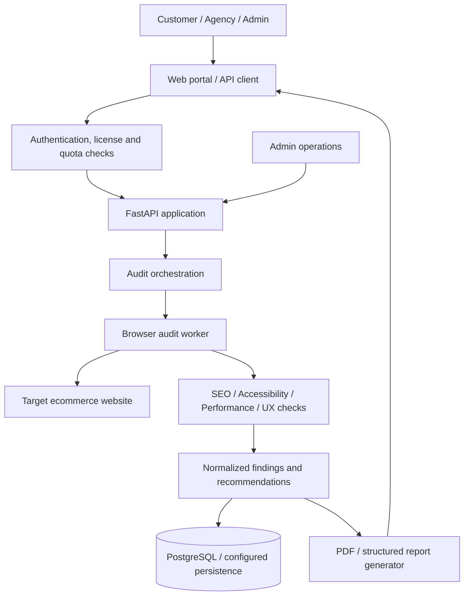

# Ecommerce Audit Agent

An AI-assisted ecommerce website audit platform built around a Python API and browser-based audit worker. It evaluates public storefronts and produces structured findings across technical SEO, accessibility, performance, crawlability, and conversion/user-experience areas, with customer-facing reports and agency/admin workflows.

## Technology and runtime

- Python API: FastAPI (project entrypoint configured as `main:app`).
- Browser audit worker: Python dependencies in `browser-worker/requirements.txt`.
- Main dependencies: `requirements.txt`, with source inputs in `requirements.in` and development dependency manifests.
- Persistence/integrations: PostgreSQL and Hostinger-compatible database integration paths are present in project documentation/source.
- Reporting: generated audit reports including PDF output.
- Authentication/licensing: API-key/license and quota-oriented workflows.

## Capabilities

- Website/storefront audit orchestration.
- Browser-driven page inspection.
- Technical SEO and crawlability checks.
- Accessibility checks.
- Performance diagnostics.
- Conversion and usability observations.
- Structured audit findings and recommendations.
- Customer, agency, and admin portal workflows.
- License/API-key validation and usage quota controls.
- PDF report generation and audit persistence.
- Security-conscious logging and credential redaction.

## Architecture

## Typical audit flow

1. Customer or agency submits an authorized public website URL.
2. API validates identity/license and applicable usage quota.
3. Audit orchestration dispatches browser inspection.
4. Browser worker visits relevant pages and gathers technical evidence.
5. Audit checks classify findings by category and severity.
6. Findings are persisted and converted into actionable recommendations.
7. Customer/agency views results and can export the report.

## Repository map

- `main.py` — configured FastAPI entrypoint.
- `browser-worker/` — browser automation worker and its dependencies.
- `requirements.txt`, `requirements.in`, `pyproject.toml` — Python dependency/build configuration.
- `docs/` — product, deployment, verification, and production-readiness material.
- Portal and service modules — account, audit, reporting, and administration workflows.

## Setup

Use the repository's Python version and install the pinned runtime dependencies from `requirements.txt`. Install browser-worker dependencies separately where required. Configure database, authentication/licensing, and external service credentials using environment variables; never commit secrets. See deployment and operations documents in `docs/` before deploying.

## Test and verification evidence

The repository contains a substantial automated test suite and a historical verification snapshot. One reviewed snapshot recorded 547 passed and 33 failed tests; this is dated evidence from that snapshot, not a fresh test run and not a statement about the current deployed state. Run the current test commands from the repository's test/development documentation before release.

## Operational notes

- Audit only websites the operator/customer is authorized to assess.
- Browser navigation should enforce SSRF protections and block private/internal network targets.
- Keep credentials and license secrets out of logs.
- Distinguish measured findings from inferred recommendations.
