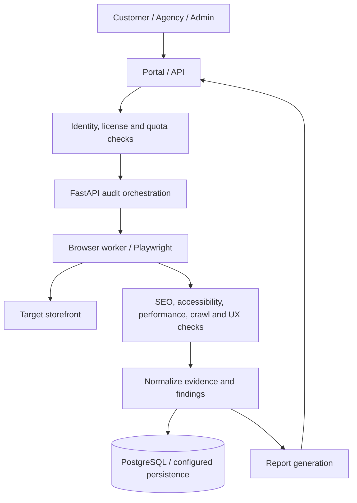

# Ecommerce Audit Agent — Project Context

> Source-based project map, reviewed 2026-11-13. Historical test snapshots are not fresh test execution.

## Purpose
AI-assisted ecommerce website audit platform that inspects storefronts and produces evidence-backed findings across technical SEO, crawlability, accessibility, performance and conversion/UX.

## Stack and dependencies
- API: Python / FastAPI; configured entrypoint `main:app`.
- Browser worker: Python + Playwright.
- Persistence: PostgreSQL and Hostinger-compatible integration paths.
- Manifests: `requirements.txt`, `requirements.in`, `requirements-dev.txt`, `requirements-dev.in`, `pyproject.toml`, `browser-worker/requirements.txt`.
- Reporting: structured and PDF reports; customer/agency/admin workflows.

## Architecture

## Flow
1. User submits a storefront URL and audit options.
2. API validates account/license and quota.
3. Orchestrator schedules browser inspection.
4. Worker collects page evidence and runs audit checks.
5. Findings are normalized, prioritized and persisted.
6. Report service produces structured/PDF output for the relevant workspace.
7. Customer/agency/admin views results according to permissions.

## Feature inventory
- Website/storefront audit orchestration and browser inspection.
- Technical SEO, crawlability, accessibility, performance and conversion/UX diagnostics.
- Structured findings, severity and recommendations.
- Customer, agency and admin portal workflows.
- API-key/license validation and usage quota controls.
- PostgreSQL persistence and PDF reporting.
- Security-conscious logging and credential redaction.

## Roadmap
1. Consolidate the canonical setup and test commands in this README.
2. Add end-to-end tests for tenant isolation, license/quota enforcement and report access.
3. Add SSRF regression coverage for redirects, DNS rebinding, IPv4/IPv6 and private network ranges.
4. Track audit provenance, crawl timestamp and evidence for each recommendation.
5. Add performance budgets and worker concurrency/back-pressure controls.
6. Reconcile runtime and browser-worker dependency versions in a documented compatibility matrix.

## Gaps and verification register
- A historical verification snapshot recorded 547 passed / 33 failed; this is dated evidence only, not a current test verdict.
- Re-run current unit, integration and browser-worker tests before release.
- Verify all URL fetch paths block private/internal IPs after redirects and DNS resolution.
- Verify tenant isolation and authorization at API, database and report-download layers.
- Confirm production migrations, backup/restore and Hostinger database behavior in the target environment.
- Ensure PDF exports and logs do not expose credentials or cross-tenant data.
