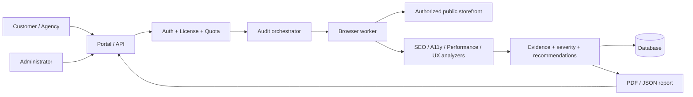
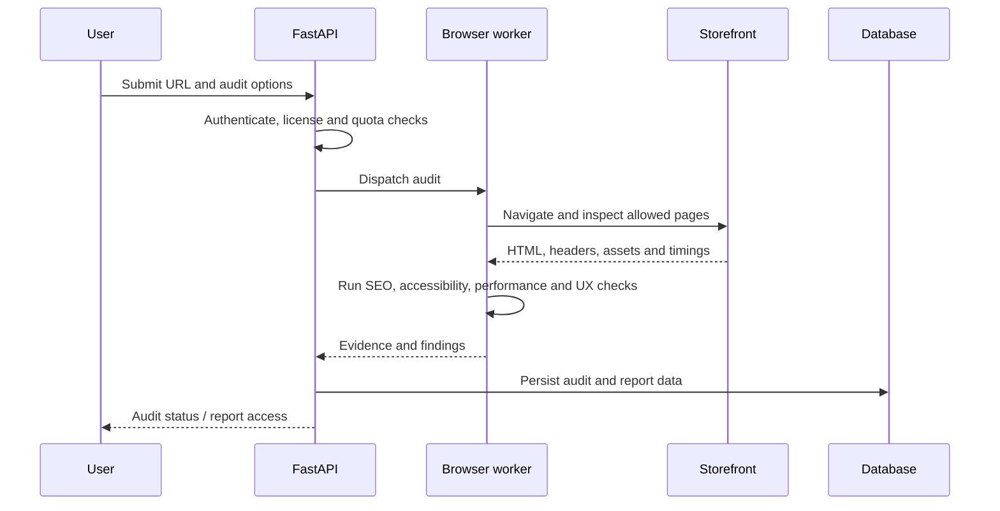

# Ecommerce Audit Agent — Requirements and System Specification

## 1. Purpose

Provide a multi-user ecommerce audit service that gathers browser-based evidence and converts it into prioritized technical and business recommendations.

## 2. Actors

- Customer/store owner requesting an audit.
- Agency user managing client audits.
- Platform administrator managing users, licenses, quotas, and operations.
- Browser worker inspecting the target website.
- External database/reporting and optional AI/integration services.

## 3. Functional requirements

| ID | Requirement | Capability |
|---|---|---|
| FR-01 | Accept audit requests for target storefront URLs | Implemented |
| FR-02 | Authenticate API/portal users and validate applicable license/API key | Implemented |
| FR-03 | Enforce usage quotas/limits | Implemented |
| FR-04 | Run browser-driven website inspection | Implemented |
| FR-05 | Evaluate technical SEO and crawlability | Implemented |
| FR-06 | Evaluate accessibility signals | Implemented |
| FR-07 | Collect performance diagnostics | Implemented |
| FR-08 | Identify conversion and usability issues | Implemented |
| FR-09 | Normalize evidence into findings and recommendations | Implemented |
| FR-10 | Persist audit data and customer history | Implemented |
| FR-11 | Generate downloadable PDF/structured reports | Implemented |
| FR-12 | Provide customer, agency, and admin workflows | Implemented |
| FR-13 | Redact sensitive credentials from operational logs | Implemented |

## 4. Architecture

## 5. Audit sequence

## 6. Non-functional requirements

- **Security:** validate URLs, prevent SSRF/private-network access, isolate browser execution, enforce tenant ownership, and redact credentials.
- **Reliability:** handle browser timeouts, partial crawl failures, retries, and report-generation errors.
- **Performance:** apply page/depth/time limits and quotas to prevent runaway audits.
- **Auditability:** preserve evidence, timestamps, severity, and recommendation rationale.
- **Privacy:** collect only data needed for the requested public-site audit and enforce retention/access controls.
- **Accessibility:** portal/report outputs should be usable with assistive technologies.
- **Portability:** support documented deployment targets and environment-based configuration.

## 7. Operational acceptance

Historical verification documents are evidence for their recorded commit only. Re-run the current automated suite and verify database migrations, browser-worker execution, authentication, quota enforcement, report generation, tenant isolation, and production integrations before a new release.

## 8. Verification checklist

- [ ] Invalid/unauthorized URL is rejected safely.
- [ ] SSRF protections block private and metadata endpoints.
- [ ] License and quota checks run server-side.
- [ ] Browser worker returns structured evidence.
- [ ] Audit categories generate actionable findings.
- [ ] Tenant users can access only their own authorized audits.
- [ ] PDF report matches persisted audit results.
- [ ] Secrets are not exposed in logs or error responses.
